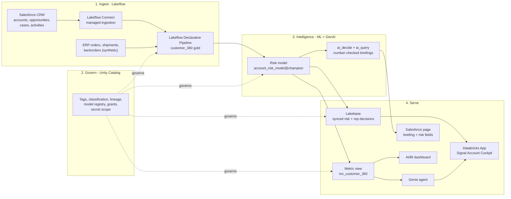

# Signal 2.0 - Stop Losing Lab-Supply Accounts You Could Have Saved

**Industry:** Life sciences tools and lab-supply distribution (Healthcare and Life Sciences)
**Buyer:** VP Commercial / Sales Operations | **Users:** field sales reps and sales managers
**Status:** working prototype, all data synthetic, every stage executed (see [evidence/](evidence/))

## The business problem

A lab-supply distributor serves hospitals, biopharma, CROs, and academic labs. When an account starts to slip, the warning signs live in different systems: **backorders and late deliveries** in the ERP, **rep inactivity and support cases** in Salesforce. Reps see the revenue drop only after it happens. Today's prioritization is a static rule (backorders + inactivity + cases), and it misses most of the accounts that are about to decline.

## The outcome

Signal 2.0 predicts which accounts will lose revenue in the next 6 months, explains why, recommends what the rep should do, and puts it where reps already work: on the Salesforce account page, in a rep worklist app, and in plain-English Q&A.

| KPI (buyer's language) | Today (rule) | With Signal 2.0 | Source |
|---|---|---|---|
| Lost revenue in front of reps when they work the top 20% of the book | 28.4% | **46.1%** | [evidence/05_business_value.md](evidence/05_business_value.md) |
| Declining accounts those reps see | 27.1% | **32.7%** | same |
| Prediction accuracy (out-of-time AUC) | 0.543 | **0.625** | [drift and model evidence](evidence/06_feature_drift.md) |
| Training data looks like the accounts being scored (score PSI, lower is better) | n/a | **0.034**, gate < 0.10 | same |
| Time from new data to updated scores in Salesforce, app, and Genie | manual | **about 4 minutes**, one job | [job run](evidence/02_refresh_job_run.md) |
| Rep opens an account (server side) | n/a | **59 ms p50** (was 979 ms) | [evidence/07_latency.md](evidence/07_latency.md) |

All figures are on the held-out test months (Jan-Feb 2026, $254.0M of revenue that was actually lost) unless noted. The worklist ranks accounts by **expected dollar loss** (probability of decline x revenue run rate), which is where most of the lift comes from: today's rule weighted by revenue reaches 42.3%, so the model's own edge on top of dollar ranking is about 4 points. Both are needed for 46.1%.

**Current book (200 accounts, $1,750.4M annual revenue; Salesforce revenue equals order revenue):** $561.4M of expected revenue at risk (annual revenue x probability of decline). $359.3M of it sits in the 80 High and Medium accounts (top 40% by expected dollar loss).

**Value.** *Measured:* with the same rep effort, 17.7 more points of the lost revenue reach reps than under today's rule, about **$45.0M** more over the two test months. *Projected, not measured:* applied to today's $561.4M, about **$99.4M** more at-risk revenue in front of reps; *assuming* reps save 25% of what they work, about **$24.8M retained per year**. The save rate is the pilot's job to measure, with a control group.

**What not to over-claim.** The model trains on synthetic history whose cause and effect was authored. It was recalibrated so its scores on real accounts match training (score PSI 0.034), but five inputs still drift and absolute accuracy (AUC 0.625) will not transfer as-is. The lift over today's rule held in every generator variant tested. First pilot task: recalibrate on real decline labels ([details](evidence/06_feature_drift.md)).

## What the rep and the manager see

1. **Salesforce account page:** a morning briefing popup with the risk score, the model's two main drivers (for example Massachusetts General Hospital: *"Revenue vs 12-mo run rate: 0.33x; Order lines with pushed delivery dates (6 mo): 80%"*), a recommended action and urgency, and three recommendations whose numbers are checked against the account's real data. Risk fields are reportable in Salesforce list views.
2. **Signal Account Cockpit (Databricks App):** a worklist ranked by expected dollar loss, so the day starts with the biggest exposure. The account panel shows the risk, the AI recommendations and deep signals, all read from Lakebase. Reps accept, snooze, or dismiss; every decision is recorded under the signed-in rep with an append-only audit row.
3. **Genie agent:** managers ask *"Which 5 accounts have the highest risk score, and what is their top risk driver?"* and get the answer, the SQL, and a chart. Genie runs with the user's own permissions.

## The integrated data journey

One job (`06_orchestration`) runs it end to end: refresh Customer 360, score with the champion model, write insights and AI briefings, push to Salesforce, refresh Lakebase, and check that Lakebase matches Delta. Unity Catalog lineage confirms every link, from the ingested Salesforce tables to the Lakebase table the app reads ([governance evidence](evidence/notebooks/01_data__03_govern_unity_catalog.md)).

| Stage | Databricks capability | Where | Evidence |
|---|---|---|---|
| Ingest | Lakeflow Connect (Salesforce, 5 objects) + Lakeflow Declarative Pipeline | `01_data/lakeflow_connect/`, `01_data/customer_360_pipeline/` | [01_lakeflow_ingestion.md](evidence/01_lakeflow_ingestion.md) |
| Govern | Unity Catalog governed tags, column classification, lineage, model registry, secret scope | `01_data/03_govern_unity_catalog` | [governance](evidence/notebooks/01_data__03_govern_unity_catalog.md) |
| ML | Point-in-time training, out-of-time validation, gated promotion, batch scoring | `02_ml/` | [training](evidence/notebooks/02_ml__02_train_risk_model.md), [scoring](evidence/notebooks/02_ml__03_score_and_brief.md) |
| Gen AI | `ai_decide` (action, urgency) + `ai_query` (recommendations) with number verification | `02_ml/03_score_and_brief` | [scoring](evidence/notebooks/02_ml__03_score_and_brief.md) |
| Operational serving | Lakebase synced table + transactional rep decisions | `04_lakebase_app/` | [Lakebase](evidence/notebooks/04_lakebase_app__01_lakebase_setup.md), [grants](evidence/notebooks/04_lakebase_app__02_app_grants.md) |
| Natural language | Genie agent on a governed metric view | `05_analytics/` | [03_genie_agent.md](evidence/03_genie_agent.md) |
| Business app | Databricks App + Salesforce page | `04_lakebase_app/app/`, `03_salesforce/` | [04_serving_salesforce_lakebase_app.md](evidence/04_serving_salesforce_lakebase_app.md) |

## Decisions and trade-offs

| Decision | Why | Trade-off |
|---|---|---|
| Logistic regression, not gradient boosting | Gives per-account drivers directly (coefficient x standardized value), so reps see *why*. A gradient-boosted model scored higher out-of-time (AUC 0.715) but failed the drift gate (score PSI 0.24) | Less capacity for complex interactions; revisit with real history |
| Train on a synthetic history at real account levels and real order cadence | The demo ERP data has no link between operational pain and later revenue, so no model could learn it. An earlier smooth history (4 orders a month) gave AUC 0.818 that did not reflect real lumpy revenue | Cause and effect comes from the generator. `HISTORY_SOURCE = "cdm"` switches to real history (needs about 23 months) |
| Out-of-time validation with three promotion gates (AUC >= 0.60, >= 0.05 above the rule, score PSI < 0.10) | Random splits overstate accuracy on time-series accounts; the drift gate stops a model whose live scores look unlike its training scores | AUC floor reflects how hard lumpy revenue is to call |
| Rank and band by expected dollar loss (top 10% High, next 30% Medium) | Catches 46.1% of lost revenue vs 35.1% ranking by probability alone; rank-based bands stay a workable size when probabilities compress | The probability is still on every record; the dollar ranking favors large accounts by design |
| Salesforce annual revenue derived from order revenue | One revenue base across Salesforce, dashboards, Genie, and the model | Salesforce revenue is no longer an independent input |
| Batch scoring, not a real-time endpoint | Risk changes when data refreshes, not per click. Salesforce reads scores from its own records, so there are no callouts or network allow-lists | Scores are as fresh as the last job run (about 4 minutes end to end) |
| Lakebase for every app read, not the SQL warehouse | Opening an account dropped from 979 ms to 59 ms (server side) once the briefing and insights were synced too; writes are transactional (decision + audit in one transaction) | Three synced tables to keep fresh; the job refreshes all three and fails if any differs from Delta |
| One metric view for Genie and the dashboard | One definition of risk, revenue at risk, and drivers; Genie and dashboards cannot disagree | Changes go through the metric view, not ad hoc SQL |
| `ai_decide` for structured choices, `ai_query` with a number check | Structured outputs are reliable; free-text numbers can be wrong, so every number is checked against the account's data and failures are withheld | Extra LLM call on retry (3 of 200 retried, 0 withheld in the last run) |
| App user authorization (scopes `genie`, `sql`) | Genie answers and audit rows use the real rep's identity and permissions | Each user must have access to the Genie agent and warehouse |

## Security and governance

- **No secrets in code:** Salesforce credentials come from the `ccg-salesforce` secret scope; `scripts/check_secrets.py` runs before every commit.
- **Least privilege in Lakebase:** the app service principal can read risk scores and append decisions and audit rows; UPDATE, DELETE, and TRUNCATE are withheld and verified.
- **Classification:** every table carries governed `data_classification`, journey stage, and `data_origin = synthetic` tags; revenue columns are `confidential`.
- **Model governance:** Unity Catalog model registry with a `champion` alias, set only when all three promotion gates pass; per-feature drift is logged to MLflow every run.

## How AI was used as a teammate

Built with **Genie Code** (Databricks' AI agent) in one workspace, with me making the product, modeling, and architecture decisions. Patterns that made the build trustworthy:

- **Evidence-first loop:** every change was run, read back, and checked by a second method (for example, Genie's answer cross-checked against the scored table; Lakebase checked against Delta after every sync).
- **AI checking AI:** the briefing step uses an LLM to write recommendations and code to verify every number before anything reaches Salesforce.
- **Regression tests on real failures:** the app's Genie renderer was tested in Node against an actual broken answer before deploying.
- **Mistakes caught and documented:** for example, an app update that dropped resources and reset database grants was diagnosed, fixed, and turned into a troubleshooting rule.

## Repository layout

| Path | What it is |
|---|---|
| [`evidence/`](evidence/) | Execution evidence as text: notebook outputs, pipeline and job runs, Genie Q&A, serving checks, value calculation |
| [`docs/`](docs/) | Business deck and roleplay preparation |
| `01_data/` | Lakeflow Connect definition, CRM data generation and Salesforce load, Customer 360 pipeline, Unity Catalog governance |
| `02_ml/` | Training history, model training, scoring and AI briefing, shared feature module |
| `03_salesforce/` | Salesforce source package and deploy notebook |
| `04_lakebase_app/` | Lakebase setup, grants, demo reset, Databricks App |
| `05_analytics/` | Metric view, Genie agent, and dashboard definitions |
| `06_orchestration/` | Refresh job definition |
| `signal_config.py` | Single source of configuration (names, IDs, secret scope) |

## Run it

1. Create the `ccg-salesforce` secret scope with `consumer-key`, `consumer-secret`, and `sf-domain` (your org's My Domain host).
2. `01_data`: generate and load CRM data, run Lakeflow Connect, the Customer 360 pipeline, and the governance notebook.
3. `03_salesforce/01_deploy_salesforce`.
4. `02_ml/01_build_training_history`, then `02_ml/02_train_risk_model`.
5. `04_lakebase_app/01_lakebase_setup` and `02_app_grants`; deploy the app from `04_lakebase_app/app`.
6. Create the job from `06_orchestration/signal_refresh_job.json`; each run refreshes everything above.

## Troubleshooting

| Symptom | Cause | Fix |
|---|---|---|
| App error `permission denied for schema cockpit` | The app's `postgres` resource was re-attached, recreating its database role without privileges | Re-run `04_lakebase_app/02_app_grants` |
| Genie in the app returns 403 | Forwarded user token lacks a scope, or the user has not consented | App scopes must include `genie` and `sql`; reopen the app to consent |
| App update drops resources | `PATCH /api/2.0/apps/{name}` without `resources` removes them | Use `POST /api/2.0/apps/{name}/update` with an `update_mask` |
| App shows old scores | Lakebase not refreshed | Run the refresh job |

All data in this repository is synthetic. No customer data is included.
